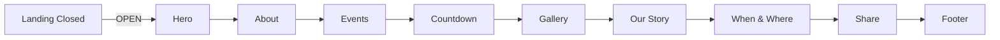

# Five Changes Design

## Goal

Five outcomes:

1. Landing `#si-landing` min-height `100svh` flex column `space-between`: garland top, Ganesha/blessing/names/button middle, `gopuram-illustration-cropped` full-bleed bottom ~218px.
2. Opened hero section at top of `#si-invitation` mirroring ref: Ganesha 80px, blessing, Great Vibes names, date "Fri 20 Nov 2026 8:56 PM" + venue Chilakaluripet lines, divider, `gopuram-watercolor`, then About Couple.
3. Scroll fix: `lenis.on('scroll', ScrollTrigger.update)` + GSAP ticker RAF + `lagSmoothing(0)`, remove `overflow-x: hidden` lock conflict (keep `clip` on body only), `ScrollTrigger.refresh()` after OPEN unhide, reveals play-once.
4. Move video to new "Our Story" 6th section (after Gallery, before When & Where): 16:9 max-width 680px, heading "Our Story", direct MP4 + poster + controls (only delta vs ref YouTube). New order: Hero → About → Events → Countdown → Gallery → Our Story → When & Where → Share → Footer.
5. About Couple: 2 cards, circular 160px placeholder initials A & D + "Photo coming soon", Son/Daughter of parent lines, `marigold-wreath.png` flanking each (download from https://myshaadhilink.in/assets/south-indian/ + banana-leaf L/R + toran-type-2), reveal on scroll.

## Non-goals

- No React/framework (vanilla sufficient).
- No YouTube embed.
- No per-event iframes.
- No RSVP return.
- No backend.
- No new build tooling.

## Alternatives

- (A) React+Vite rebuild: rejected (all 5 doable vanilla; build/CI + 49MB pipeline risk, zero UX gain).
- (B) Keep merged single scroll: rejected (user + ref require two states).
- (C) YouTube iframe: rejected (user explicitly wants direct video).

## Trade-offs

- Lenis+ST wiring ~10 lines kills stuck-scroll but adds coupling.
- Our Story move reorders anchors.
- Placeholders temporary until photos arrive.
- Bottom temple adds ~200KB image weight.

## Trace

| Req | Design | Test |
|---|---|---|
| 1 | landing 100svh flex col space-between + temple bottom | curl 200; Playwright 390: landing scrollH==844 + temple visible closed |
| 2 | opened hero at top of #si-invitation | grep counts; opened hero present |
| 3 | lenis.on scroll + ticker raf + refresh after unhide | scroll to bottom no stuck + reveals fire |
| 4 | Our Story 6th, 16:9 max 680, direct MP4 | video in Our Story 16:9 |
| 5 | 2 cards 160px initials + wreath imgs | 2 photo slots + wreath imgs |

## Review findings

Self-review: two-state preserved; `ScrollTrigger.refresh()` after unhide addresses hidden-measurement misfire; video preload metadata (not auto) until OPEN; wreath assets hotlist documented.

## Leading indicators

- Landing scrollH==innerH closed.
- Opened hero first visible.
- Full scroll top→bottom no lock 390+desktop.
- Video 206 streaming.
- 0 console errors.

## Flow

