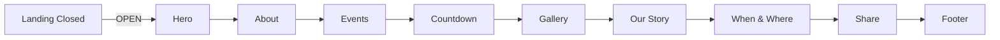

# Five Changes Implementation Plan

## Goal

Ship five outcomes on the single-page South-Indian wedding invitation (Venkata Aditya Kumar & Naga Deepa, 20 Nov 2026): (1) landing `#si-landing` becomes a `100svh` flex column (`space-between`) with garland top, middle block, and `gopuram-illustration-cropped` full-bleed bottom (~218px); (2) opened hero at top of `#si-invitation` mirroring the ref (Ganesha 80px, blessing, Great Vibes names, date "Fri 20 Nov 2026 8:56 PM" + Chilakaluripet venue lines, divider, `gopuram-watercolor`), then About Couple; (3) scroll fix (Lenis `scroll` → `ScrollTrigger.update`, GSAP ticker RAF, `lagSmoothing(0)`, drop `overflow-x: hidden` lock conflict keeping `clip` on body only, `ScrollTrigger.refresh()` after OPEN unhide, play-once reveals); (4) move video to new "Our Story" 6th section (after Gallery, before When & Where) — 16:9, max-width 680px, heading "Our Story", direct MP4 + poster + controls (delta vs ref YouTube) — with new order Hero → About → Events → Countdown → Gallery → Our Story → When & Where → Share → Footer; (5) About Couple as 2 cards with circular 160px placeholder initials A & D + "Photo coming soon", Son/Daughter of parent lines, `marigold-wreath.png` flanking each, reveal on scroll. Verify (`curl` 200 + Playwright 390/desktop no overflow, 0 console errors) and republish to GitHub Pages. Docs-only plan task (this file) — no code edits performed here.

## Flowchart

## Architecture

| Layer | Element | Role |
|-------|---------|------|
| HTML | `index.html` `#si-landing` | Flex column `100svh`, `space-between`; garland top; middle block (Ganesha/blessing/names/button); `gopuram-illustration-cropped` full-bleed bottom ~218px |
| HTML | `index.html` top of `#si-invitation` | Opened hero (Ganesha 80px, blessing, Great Vibes names, date+venue lines, divider, `gopuram-watercolor`), then About Couple |
| HTML | `index.html` `#si-invitation` | About Couple: 2 cards, circular 160px placeholder initials A & D + "Photo coming soon", Son/Daughter parent lines, `marigold-wreath.png` flanking each |
| HTML | `index.html` new `section.si-story-video` (Our Story) | 6th section after Gallery, before When & Where; 16:9 max-width 680px; heading "Our Story"; direct `<video>` MP4 + poster + controls |
| CSS | `styles.css` | Landing flex layout; hero/about/our-story styling; overflow lock fix (`clip` on body only); clamp typography |
| JS | `script.js` | Lenis `scroll` → `ScrollTrigger.update`; GSAP ticker RAF; `lagSmoothing(0)`; `ScrollTrigger.refresh()` after OPEN unhide; play-once reveals; video handling |
| Assets | `assets/south-indian/` | `marigold-wreath.png`, `toran-type-2.png` (download from ref); reuse `ganesha.png`, `gopuram-watercolor.png`, `gopuram-illustration-cropped.png`, `gold-divider.svg`, `garland-header.png` |
| Serve/verify | `python3 -m http.server`, `curl`, Playwright @390px + desktop | HTTP 200, no horizontal overflow, 0 console errors |
| Publish | GitHub Pages (`main`, root) | Republish after verify |

## Stack

- HTML5, CSS3 (custom properties, clamp, media queries, flexbox), vanilla JS (existing only)
- Lenis 1.1.16 + GSAP 3.12.5 + ScrollTrigger (CDN, already loaded)
- Google Fonts (Cormorant, Great Vibes, Plus Jakarta Sans); maps links are `<a>` href only
- Local assets only; no new build tooling, no backend, no framework
- Host: GitHub Pages (free, public repo)

## Spec

Source of truth: `docs/plans/five-changes-design.md` (design session). Decisions traced:
- landing: `#si-landing` min-height `100svh` flex column `space-between`: garland top, Ganesha/blessing/names/button middle, `gopuram-illustration-cropped` full-bleed bottom ~218px
- opened hero at top of `#si-invitation` mirroring ref: Ganesha 80px, blessing, Great Vibes names, date "Fri 20 Nov 2026 8:56 PM" + venue Chilakaluripet lines, divider, `gopuram-watercolor`, then About Couple
- scroll fix: `lenis.on('scroll', ScrollTrigger.update)` + GSAP ticker RAF + `lagSmoothing(0)`, remove `overflow-x: hidden` lock conflict (keep `clip` on body only), `ScrollTrigger.refresh()` after OPEN unhide, reveals play-once
- Our Story 6th section (after Gallery, before When & Where): 16:9 max-width 680px, heading "Our Story", direct MP4 + poster + controls (delta vs ref YouTube); new order Hero → About → Events → Countdown → Gallery → Our Story → When & Where → Share → Footer
- About Couple: 2 cards, circular 160px placeholder initials A & D + "Photo coming soon", Son/Daughter of parent lines, `marigold-wreath.png` flanking each (download from ref + `toran-type-2`), reveal on scroll
- non-goals: no React/framework, no YouTube embed, no per-event iframes, no RSVP return, no backend, no new build tooling

## Constraints

- This task (plan doc) edits only `docs/plans/five-changes-plan.md`; no code/assets changes here.
- Implementation later must not add a framework or build step; vanilla only.
- Implementation must keep two-state model (`body[data-state]` closed/open); no merged single scroll.
- Direct MP4 only for Our Story (no YouTube iframe); video `preload="metadata"`, no autoplay before OPEN.
- `overflow-x: clip` retained on body; remove conflicting `overflow-x: hidden` lock (do not reintroduce `hidden`).
- Reveals play-once (`toggleActions: 'play none none none'` / `io.unobserve`).
- Assets: download `marigold-wreath.png` and `toran-type-2.png` from ref; `banana-leaf` L/R not present on ref (flag and reuse `toran-type-1`/omit) — no fabricated binaries.
- Minimal premium spacing; clamp-responsive typography; no horizontal overflow at 390px and desktop.
- No secrets; free-only hosting.

## Review focus

- Two-state preserved: landing hidden after OPEN; invitation unhidden then `ScrollTrigger.refresh()`.
- Lenis/ST wiring ordering: init Lenis → `lenis.on('scroll', ScrollTrigger.update)` → `gsap.ticker.add((t)=>lenis.raf(t*1000))` → `gsap.ticker.lagSmoothing(0)`.
- Landing `scrollHeight == innerHeight` when closed (no scroll).
- Our Story video max-width 680px, aspect-ratio 16/9, controls present, poster set.
- About Couple placeholders are accessible (alt text, "Photo coming soon").
- Asset hotlist downloaded and referenced with correct relative paths.
- No console errors; no overflow at 390px and desktop.

## Tasks

| # | Task | Files | Test | Expected | Verify |
|---|------|-------|------|----------|--------|
| 1 | Landing: `#si-landing` min-height `100svh` flex column `space-between` — garland top, Ganesha/blessing/names/button middle, `gopuram-illustration-cropped` full-bleed bottom ~218px | `index.html`, `styles.css` | Render closed state | Landing fills viewport; temple visible at bottom; no scroll | `curl` 200; Playwright @390 closed: `#si-landing` `scrollHeight === innerHeight` (844) + temple img visible |
| 2 | Opened hero at top of `#si-invitation` + About Couple + assets: Ganesha 80px, blessing, Great Vibes names, date "Fri 20 Nov 2026 8:56 PM" + Chilakaluripet lines, divider, `gopuram-watercolor`; then 2 cards (circular 160px placeholders initials A & D + "Photo coming soon", Son/Daughter parent lines, `marigold-wreath.png` flanking), reveal on scroll | `index.html`, `styles.css`, `assets/south-indian/marigold-wreath.png`, `assets/south-indian/toran-type-2.png` | Render opened state | Opened hero first visible; About Couple 2 cards with wreath imgs | grep counts; Playwright opened: hero first visible; 2 photo slots + 2 wreath imgs |
| 3 | Scroll fix: `lenis.on('scroll', ScrollTrigger.update)` + GSAP ticker RAF + `lagSmoothing(0)`; remove `overflow-x: hidden` lock conflict (keep `clip` on body only); `ScrollTrigger.refresh()` after OPEN unhide; reveals play-once | `script.js`, `styles.css` | Scroll full opened page @390 + desktop | No stuck scroll; reveals fire once | Playwright scroll top→bottom no lock; `revealed` classes present; 0 console errors |
| 4 | Our Story + order: new 6th section after Gallery before When & Where — 16:9 max-width 680px, heading "Our Story", direct MP4 + poster + controls; reorder to Hero → About → Events → Countdown → Gallery → Our Story → When & Where → Share → Footer | `index.html`, `styles.css`, `script.js` | Render opened state | Video in Our Story 16:9; section order updated | grep section order; Playwright: video in Our Story; 206 streaming |
| 5 | Verify + republish: `curl` 200, Playwright @390 + desktop no overflow, 0 console errors, then `git push origin main` GitHub Pages | (verification only) | curl + Playwright + git | Site live, no regressions | `curl -s -o /dev/null -w "%{http_code}"` == 200; Playwright no overflow; `git push origin main` Pages deploy |

## Per-task notes

- Task 1: keep `#si-landing` as the only visible node in closed state; move `gopuram-illustration-cropped.png` to bottom slot with `width:100%`, `height:auto`, `max-height:218px`, `object-fit:cover`, `margin-top:auto`.
- Task 2: opened hero reuses existing `ganesha.png` at `width:80px`; names in Great Vibes; date line exact "Fri 20 Nov 2026 8:56 PM"; venue line "Chilakaluripet" (and reception "23 Nov · Guntur" secondary). Download `marigold-wreath.png` + `toran-type-2.png` from ref; `marigold-wreath.png` flanks each 160px circle (`position:absolute`, full-size behind placeholder). Placeholder initials "A" and "D" with "Photo coming soon" caption. Parents: "Son of <strong>Ramesh Babu</strong> & <strong>Siromani</strong>" / "Daughter of <strong>Surya Narayana</strong> & <strong>Aadhi Lakshmi</strong>".
- Task 3: in `script.js`, after Lenis init add `lenis.on('scroll', ScrollTrigger.update)`; replace `requestAnimationFrame(raf)` loop with `gsap.ticker.add((time)=>{ lenis.raf(time*1000); if (progressFill) setProgress(lenis.progress*100); })`; `gsap.ticker.lagSmoothing(0)`. In CSS, change `html { overflow-x: clip }` to `overflow-x: visible` (or remove) and keep `body { overflow-x: clip }`. On OPEN handler: after `invitation.removeAttribute('hidden')`, call `ScrollTrigger.refresh()` (guarded). Reveals already play-once via `toggleActions:'play none none none'` and IO `unobserve`.
- Task 4: remove `<video>` from About Couple/hero; create Our Story section after Gallery with `<video controls preload="metadata" poster="assets/hero-poster.jpg"><source src="assets/hero-loop.mp4" type="video/mp4"></video>` inside `.si-story-video-wrap` (`max-width:680px; aspect-ratio:16/9`). Update `script.js` video selectors to target `.si-story-video-wrap video` (keep pause button). Reorder sections in DOM.
- Task 5: run local server, curl, Playwright @390 + desktop, check console; commit and `git push origin main`.

## Coverage checklist

- [ ] Task 1: landing min-height `100svh` flex column `space-between`
- [ ] Task 1: garland top + middle block + temple bottom ~218px
- [ ] Task 1: closed landing `scrollHeight == innerHeight` (844) @390
- [ ] Task 2: opened hero present at top of `#si-invitation`
- [ ] Task 2: Ganesha 80px, blessing, Great Vibes names, date "Fri 20 Nov 2026 8:56 PM", Chilakaluripet lines, divider, `gopuram-watercolor`
- [ ] Task 2: About Couple 2 cards, circular 160px placeholders initials A & D, "Photo coming soon"
- [ ] Task 2: Son/Daughter parent lines present
- [ ] Task 2: `marigold-wreath.png` flanking each (2 imgs)
- [ ] Task 2: `toran-type-2.png` downloaded (if used) and referenced
- [ ] Task 2: reveals on scroll
- [ ] Task 3: `lenis.on('scroll', ScrollTrigger.update)` present
- [ ] Task 3: GSAP ticker RAF + `lagSmoothing(0)` present
- [ ] Task 3: `overflow-x: hidden` lock removed; `clip` kept on body
- [ ] Task 3: `ScrollTrigger.refresh()` called after OPEN unhide
- [ ] Task 3: reveals play-once
- [ ] Task 3: full scroll top→bottom no lock @390 + desktop
- [ ] Task 4: Our Story section after Gallery, before When & Where
- [ ] Task 4: 16:9 max-width 680px, heading "Our Story", direct MP4 + poster + controls
- [ ] Task 4: new section order Hero → About → Events → Countdown → Gallery → Our Story → When & Where → Share → Footer
- [ ] Task 4: video 206 streaming
- [ ] Task 5: `curl` returns HTTP 200
- [ ] Task 5: Playwright @390 + desktop — no horizontal overflow
- [ ] Task 5: 0 console errors
- [ ] Task 5: republished to GitHub Pages
- [ ] Boundary: no framework/build/backend added

## Self-review

- Two-state preserved (closed landing only / open invitation only); `ScrollTrigger.refresh()` after unhide avoids hidden-measurement misfire.
- Direct MP4 (no YouTube) per user; `preload="metadata"` and no autoplay before OPEN.
- Placeholders temporary until photos arrive; initials A & D.
- Asset hotlist (`marigold-wreath.png`, `toran-type-2.png`) downloaded from ref; `banana-leaf` L/R unavailable on ref and flagged (reuse `toran-type-1` or omit) — no fabricated binaries.
- Bottom temple adds ~200KB image weight (already local).
- Lenis+ST wiring ~10 lines kills stuck-scroll at cost of coupling.
- Our Story move reorders anchors; verify links still resolve.