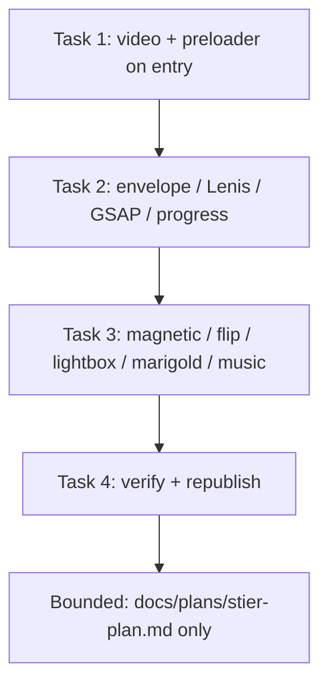

# S-Tier Plan — Wedding Invitation Polish

## Goal

Upgrade the single-page South-Indian wedding invitation (Venkata Aditya Kumar & Naga Deepa, 20 Nov 2026) to S-tier polish: video + preloader on entry, Lenis smooth-scroll + GSAP reveal progress, magnetic buttons, flip cards, lightbox gallery, marigold motif, background music toggle, then verify (curl 200 + Playwright 390px no overflow) and republish to GitHub Pages. Docs-only plan — no code edits to index.html, styles.css, script.js, or assets/ in this task.

## Flowchart

## Architecture

| Layer | Element | Role |
|-------|---------|------|
| HTML | `index.html` `.si-video`, `#si-envelope` | Video entry with preloader; envelope overlay as entry gate |
| HTML | `index.html` `.si-gal-figure` figures | Lightbox targets for gallery images |
| HTML | `index.html` `.si-rbtn`, `.si-share-link` | Magnetic button targets |
| HTML | `index.html` `.si-event-item` cards | Flip-card candidates (wedding / Vratham / reception) |
| HTML | `index.html` footer/motifs | Marigold/toran/gold-divider decorative motifs |
| CSS | `styles.css` | Preloader, envelope, Lenis `lenis` class, GSAP reveal classes, magnetic/flip/lightbox/marigold/music styles, clamp typography |
| JS | `script.js` | Music toggle (`music-toggle`), Lenis init (guarded), `reveal` IntersectionObserver, RSVP/share handlers |
| Stack | HTML5, CSS3 (custom properties, clamp, media queries), vanilla JS | No new build step; Lenis/GSAP via CDN or local vendor if added |
| Serve/verify | `python3 -m http.server`, `curl`, Playwright @390px | Local serve, HTTP 200 check, no-overflow screenshot/diff |
| Publish | GitHub Pages branch `main`, folder `/` | Republish after verify |

## Stack

- HTML5, CSS3 (custom properties, clamp(), media queries), vanilla JS (existing only)
- Lenis smooth-scroll (already guarded in script.js)
- GSAP (reveal/progress animations — to be loaded per plan)
- Google Fonts only external load (Cormorant Garamond, Inter); maps links are `<a>` href only
- Local assets: `assets/wedding_invite.jpg`, `assets/acd69cc8-... .MP4`, `assets/south-indian/*`
- Host: GitHub Pages (free, public repo)

## Spec

Source of truth: this plan (planner session `ses_e43c563f7ffeJqDaFJx7wVj7Kl`). Decisions traced:
- entry: preloader covers video until play-ready, then fades; envelope "Open Invitation" opens main content
- smooth-scroll: Lenis on `html`; `reveal` entries GSAP-staggered with scroll progress
- interactions: magnetic CTAs, flip event cards, lightbox gallery, marigold motif, background music toggle
- verify: `curl` HTTP 200; Playwright @390px no horizontal overflow
- republish: git push `main` → GitHub Pages
- docs-only: index.html, styles.css, script.js, assets/ untouched in this task

## Constraints

- No edits to index.html, styles.css, or script.js (this task: plan doc only).
- No new assets in assets/.
- No backend; RSVP stays client-side (mailto/WhatsApp/ICS as today).
- Music toggle: user gesture required; no autoplay audio.
- Exactly one video entry path; preloader must not block accessibility.
- Minimal premium spacing; clamp-responsive typography; no overflow at 390px / 360x740.
- Docs-only decision confirmed.

## Review findings (baseline)

- `index.html` already has envelope overlay (`#si-envelope`, `si-open-invitation`), video section (`si-video`, 49MB 63s MP4, poster JPG), events grid with 3 rows, gallery grid (6 figures sharing `wedding_invite.jpg`), RSVP form + share buttons, footer motifs (gold-divider, gopuram).
- `styles.css` uses maroon/gold/ivory, clamp fonts/padding, `overflow-x: clip`, `max-width:100%`, visually-hidden convention; `reveal` classes present but unanimated.
- `script.js`: music toggle wired to `#music-toggle` (button not present in index.html — gap), Lenis guarded init, `reveal` IntersectionObserver adds `revealed` class, video play fallback on load/tap, RSVP WhatsApp/ICalendar/copy handlers.
- Gaps to close in implementation: `#music-toggle` markup missing; no magnetic/flip/lightbox/marigold classes; no preloader markup; Lenis/GSAP not loaded; no scroll-progress indicator.
- Docs-only decision confirmed for this task.

## Tasks

| # | Task | Files | Test | Expected | Verify |
|---|------|-------|------|----------|--------|
| 1 | Video + preloader on entry | index.html, styles.css, script.js | Render page | Preloader shows until video play-ready, then fades; video plays on load/tap | Open index.html; inspect preloader overlay; confirm `.si-video video` plays and preloader removed |
| 2 | Envelope / Lenis / GSAP / progress | index.html, styles.css, script.js | Interact + scroll | Envelope opens main content; Lenis smooth-scroll active; GSAP `reveal` stagger; scroll-progress bar moves | Click `#si-open-invitation`; scroll page; check `html.lenis`, `revealed` classes, progress bar position |
| 3 | Magnetic / flip / lightbox / marigold / music | index.html, styles.css, script.js | Interact | Magnetic pull on CTAs; flip event cards on tap/hover; lightbox opens gallery image; marigold motif rendered; music toggle mutes/unmutes | Click/tap magnetic buttons, flip cards, gallery figures, marigold elements; toggle music; confirm states change |
| 4 | Verify + republish | index.html, styles.css, script.js | curl + Playwright @390px | `curl` returns 200; Playwright at 390px shows no horizontal overflow; site republished to GitHub Pages | `curl -s -o /dev/null -w "%{http_code}"` == 200; Playwright screenshot/diff at width 390: no overflow; `git push origin main` Pages deploy |

## Coverage checklist

- [ ] Task 1: preloader present on entry, fades when video play-ready
- [ ] Task 1: video plays on load and tap (muted/loop/autoplay fallback)
- [ ] Task 2: envelope "Open Invitation" reveals main content
- [ ] Task 2: `html.lenis` class present; smooth-scroll works
- [ ] Task 2: GSAP `reveal` stagger on scroll; `revealed` class added
- [ ] Task 2: scroll-progress bar moves with scroll
- [ ] Task 3: magnetic CTAs exhibit pull effect
- [ ] Task 3: event cards flip on tap/hover
- [ ] Task 3: gallery lightbox opens image on figure tap
- [ ] Task 3: marigold motif rendered in footer/motif zones
- [ ] Task 3: music toggle mutes/unmutes (user gesture, no autoplay)
- [ ] Task 4: `curl` returns HTTP 200
- [ ] Task 4: Playwright @390px — no horizontal overflow
- [ ] Task 4: republished to GitHub Pages (main branch, root folder)
- [ ] Boundary: index.html, styles.css, script.js, assets/ unchanged (docs-only)
