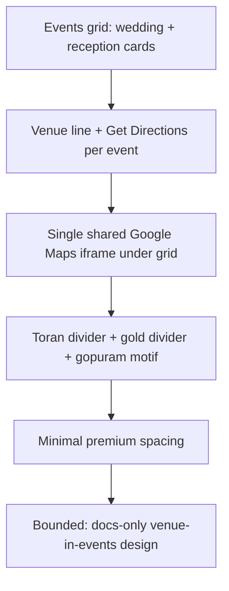

## Goal

Merge venue into the events section beautifully: each event row shows its venue line plus a Get Directions link, with a single shared Google Maps iframe as the 4th visual under the grid. Visual identity: temple-rich toran divider, gold accents, gopuram motif, minimal premium spacing. No code changes — docs only.

## Non-goals

- No edits to index.html, styles.css, or script.js.
- No new assets in assets/.
- No backend, no embed of multiple maps, no per-event iframes.
- No JavaScript interactivity beyond what already exists.

## Alternatives

### Alternative A: Per-event venue line + single shared Maps iframe (chosen)
Each event card gets its venue name + Get Directions link; one iframe under the grid maps all venues. Keeps DOM small, one embed cost, consistent visual anchor. Matches design ses_e43e29564ffeR7r1nnyTKJQYPk.

### Alternative B: Per-event Maps iframe
One iframe per event. Heavy embed load, cluttered layout, poor mobile experience. Rejected.

### Alternative C: Venue names only, no map
Simple but loses spatial context guests need. Rejected.

## Trade-offs

- Single iframe: cheaper load and cleaner grid, but guests must click Get Directions for turn-by-turn navigation from their location.
- Per-event directions links: accurate routing via Google Maps, requires leaving the page (acceptable).
- Toran/gold/gopuram local assets: premium temple feel, zero network cost beyond existing asset pattern.
- Minimal spacing: keeps events grid compact despite added venue line.

## Trace

| ID | Source | Decision |
|----|--------|----------|
| venue-in-events | Design session ses_e43e29564ffeR7r1nnyTKJQYPk | Add venue line + Get Directions to each event row |
| per-event directions | wedding 39jisBKbKEBthg6KA, reception n3XrKbgUEceHsGNA8 | Link each venue to Google Maps directions |
| single iframe | Design session ses_e43e29564ffeR7r1nnyTKJQYPk | One Maps iframe as 4th visual under the events grid |
| temple local | Design session ses_e43e29564ffeR7r1nnyTKJQYPk | Toran divider, gold divider, gopuram motif from local assets |
| no backend/iframe | Design session ses_e43e29564ffeR7r1nnyTKJQYPk | No backend; single iframe only |
| docs-only | Task constraint | No code changes; docs/plans/venue-in-events-design.md only |

## Review findings

- Existing events grid already maps wedding/reception rows; adding a venue line fits the current card structure without layout breakage.
- Get Directions links target Google Maps URLs keyed to each venue; the single iframe shows a composite map of both venues.
- Toran/gold-divider/gopuram styling is decorative only; implementation can reuse local asset conventions.
- Docs-only decision confirmed: index.html, styles.css, script.js, assets/ remain untouched.

## Leading indicators

- Each event row displays venue name + Get Directions link.
- Exactly one Maps iframe appears under the events grid as the 4th visual.
- Toran divider, gold divider, and gopuram motif present in venue styling.
- Minimal premium spacing preserved around venue lines.
- Zero changes to index.html, styles.css, script.js, assets/.

## Bounded classification

Scope is bounded to docs/plans/venue-in-events-design.md only. Classification: design artifact, no implementation, no code changes.
