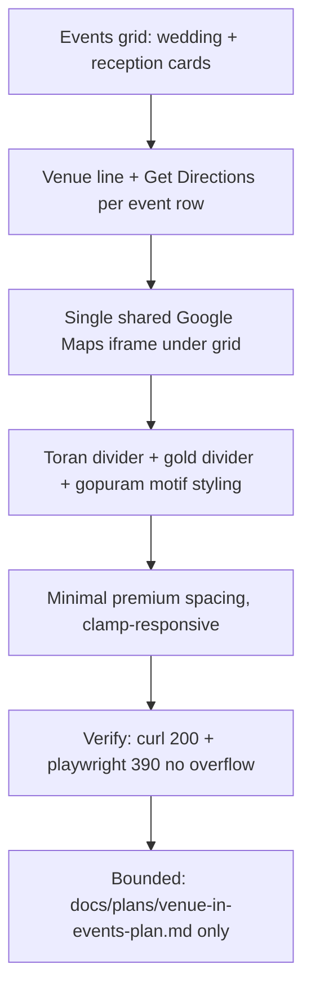

# Venue-in-Events Implementation Plan

## Goal

Merge venue into the events section beautifully: each event row shows its venue line plus a Get Directions link, with a single shared Google Maps iframe as the 4th visual under the grid. Visual identity: temple-rich toran divider, gold accents, gopuram motif, minimal premium spacing. Docs-only plan — no code changes to index.html, styles.css, script.js, or assets/.

## Flowchart

## Architecture

| Layer | Element | Role |
|-------|---------|------|
| HTML | `index.html` `si-event-item` rows | Each event row: date, name, place line, Get Directions link |
| HTML | `index.html` under `.si-event-list` | Single `<iframe class="si-ven-map">` as 4th visual after grid |
| CSS | `styles.css` `.si-ven-map`, `.si-event-directions` | Map iframe clamp; directions link styling |
| CSS | `styles.css` toran/gold/gopuram motifs | Temple dividers + gopuram illustration, clamp-responsive |
| JS | `script.js` | Unchanged — no interactivity added |

## Stack

- HTML5, CSS3 (custom properties, clamp, media queries), vanilla JS (existing only)
- Google Maps embed iframe (single, shared)
- Local assets only: `assets/south-indian/gold-divider.svg`, `assets/south-indian/gopuram-illustration-cropped.png`
- Serve: `python3 -m http.server`; verify: `curl`, Playwright @ 390px

## Spec

Source of truth: `docs/plans/venue-in-events-design.md` (design session ses_e43e29564ffeR7r1nnyTKJQYPk). Decisions traced:
- venue-in-events: add venue line + Get Directions to each event row
- per-event directions: wedding `39jisBKbKEBthg6KA`, reception `n3XrKbgUEceHsGNA8` Google Maps links
- single iframe: one Maps iframe as 4th visual under the events grid
- temple local: toran divider, gold divider, gopuram motif from local assets
- docs-only: index.html, styles.css, script.js, assets/ untouched

## Constraints

- No edits to index.html, styles.css, or script.js (this task: plan doc only).
- No new assets in assets/.
- No backend; no per-event iframes; exactly one Maps iframe total.
- No JavaScript interactivity beyond what already exists.
- Minimal premium spacing; clamp-responsive typography; no overflow at 390px.

## Review findings (baseline)

- Events grid already maps wedding/reception rows; venue line fits current card structure.
- Wedding and Reception rows have `si-event-directions` Get Directions links; Vratham row has place "At residence" without a directions link (decision point for implementation).
- `.si-ven-map` CSS exists (300px height, border-radius, margin-top) but no `<iframe>` markup exists under the grid — the single gap.
- Toran/gold-divider/gopuram styling is decorative; reuse local asset conventions.
- Docs-only decision confirmed.

## Tasks

| # | Task | Files | Test | Expected | Verify |
|---|------|-------|------|----------|--------|
| 1 | Venue lines: 3 place lines + 2 Get Directions links across event rows | index.html | Render events section | Wedding & Reception rows show place + Get Directions; Vratham shows place line | Open index.html; inspect `.si-event-place` ×3, `.si-event-directions` ×2 |
| 2 | Single `si-ven-map` iframe under the events grid | index.html | Render page | Exactly one `<iframe class="si-ven-map">` as 4th visual under `.si-event-list` | Count `.si-ven-map` iframes == 1; position after grid |
| 3 | Toran / gold / gopuram + clamp motifs | styles.css | Inspect CSS | `gold-divider`, toran divider, `gopuram` motif present; clamp() on typography/spacing | grep styles.css for gold-divider/gopuram/clamp; confirm min premium spacing |
| 4 | Verify + republish | index.html, styles.css | curl + Playwright @390px | `curl -s -o /dev/null -w "%{http_code}"` returns 200; Playwright at 390px shows no overflow | `curl` 200; Playwright screenshot/diff at width 390: no horizontal overflow |

## Coverage checklist

- [ ] Task 1: 3 venue place lines present in events rows
- [ ] Task 1: 2 Get Directions links (wedding, reception) present
- [ ] Task 2: exactly one `.si-ven-map` iframe under grid (4th visual)
- [ ] Task 2: no per-event iframes; no second map embed
- [ ] Task 3: toran divider, gold divider, gopuram motif present
- [ ] Task 3: clamp-responsive typography/spacing preserved
- [ ] Task 4: `curl` returns HTTP 200
- [ ] Task 4: Playwright @390px — no horizontal overflow
- [ ] Boundary: index.html, styles.css, script.js, assets/ unchanged (docs-only)